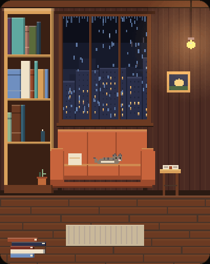
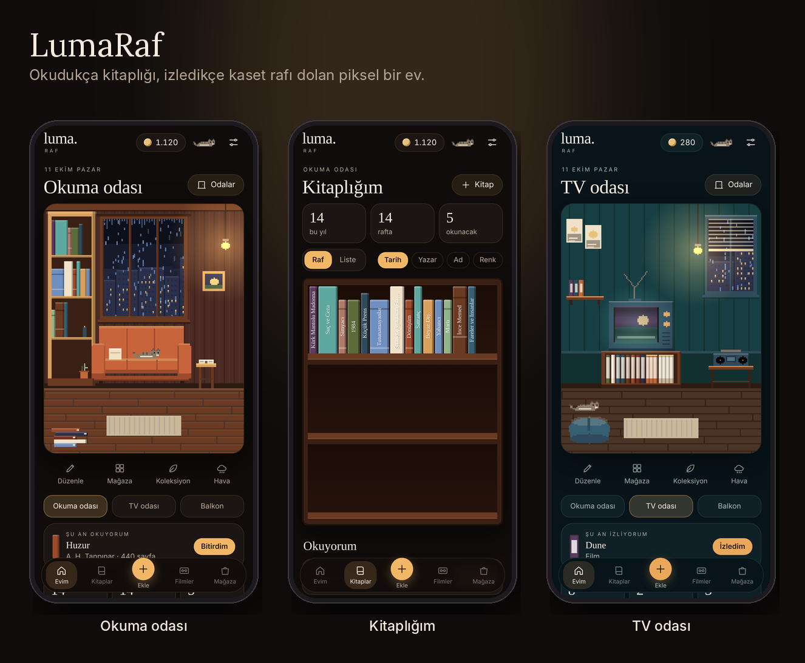
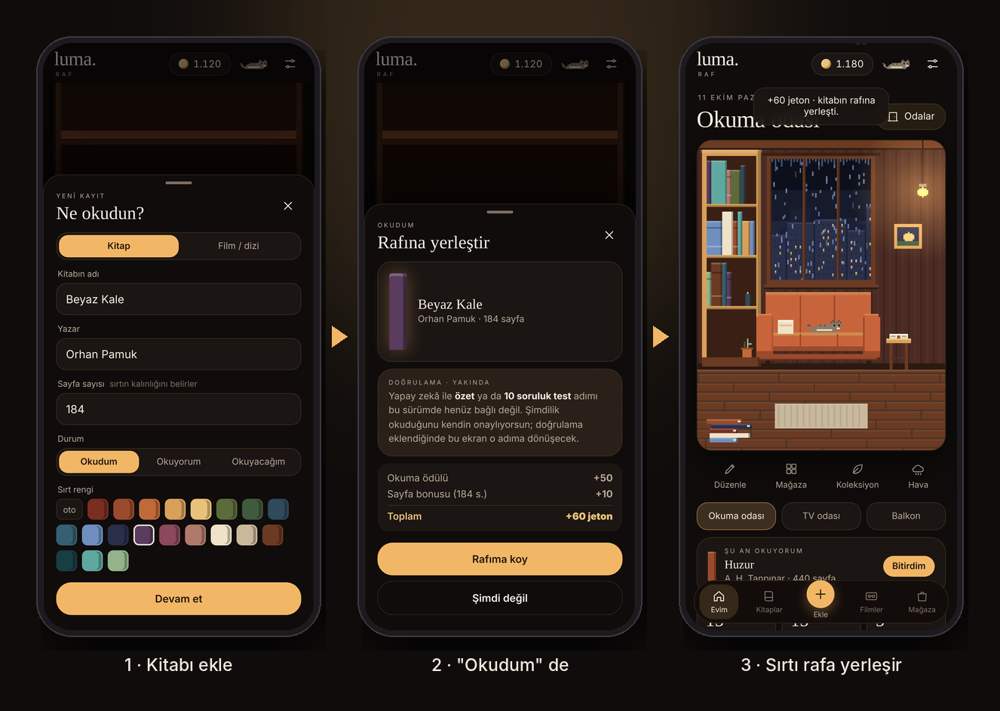
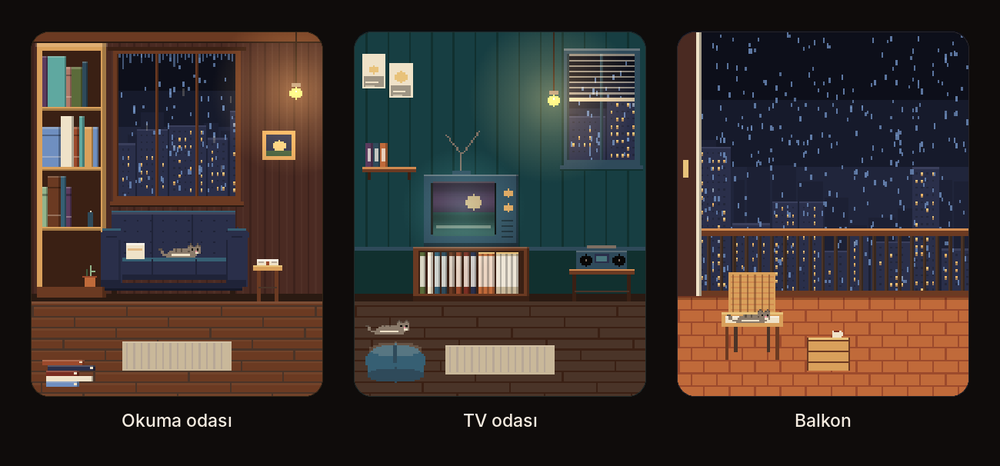
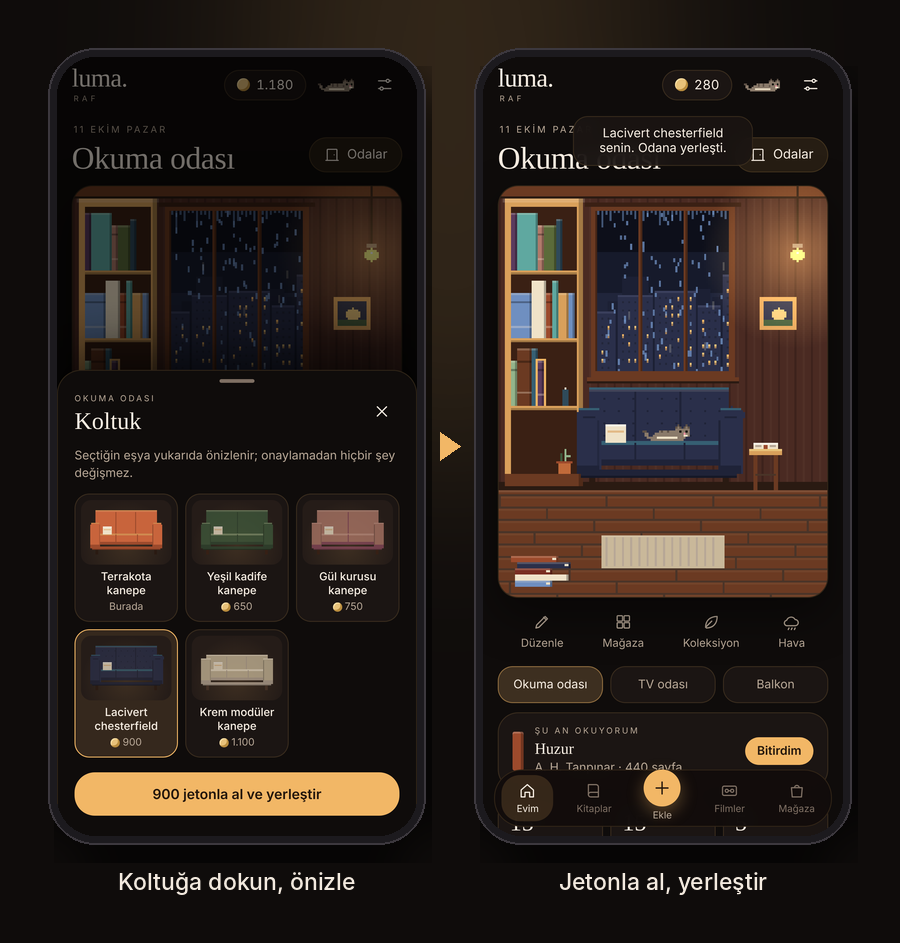
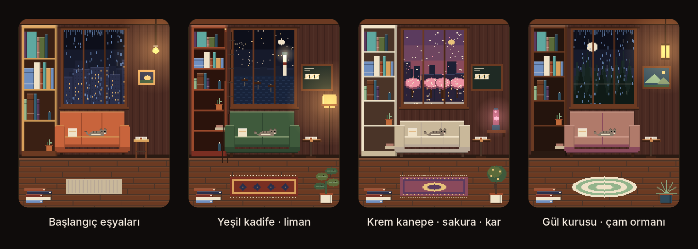
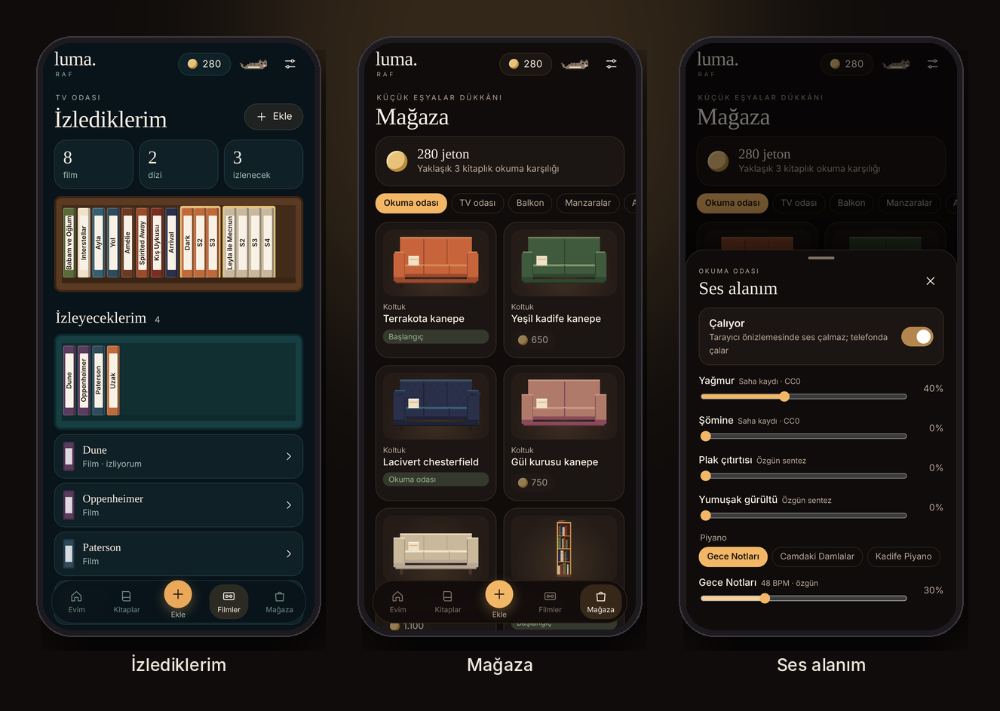

<p align="center">
  
</p>

<h1 align="center">LumaRaf</h1>

<p align="center">
  <b>Okudukça kitaplığı, izledikçe kaset rafı dolan piksel bir ev.</b><br>
  Expo · React Native · iOS / Android · Expo SDK 57
</p>

---

LumaRaf, okuduğun kitapları ve izlediğin filmleri bir listeye yazmak yerine **kendi küçük evinde biriktirdiğin** bir telefon uygulaması. Okuduğun her kitap okuma odandaki rafa bir sırt olarak yerleşiyor, izlediğin her film TV ünitesindeki kutuya bir kaset olarak giriyor. Kazandığın jetonlarla evini döşüyorsun: koltuğu, lambayı, pencereden görünen manzarayı değiştiriyorsun. Arkada yağmur ve piyano çalıyor, koltukta bir kedi uyuyor.

<p align="center">
  
</p>

## Nasıl çalışıyor?

```
 okumayı planla  →  oku  →  "okudum" de  →  sırt rafa yerleşir  →  jetonla evini döşe
 (yerde yığın)     (sehpada)                  (+ jeton)              (koltuk, lamba, manzara…)
```

Bir kitabın evdeki hâli, onunla ilişkine göre değişir:

| Durum | Evde nerede durur? |
|---|---|
| **Okuyacağım** | Kitaplığın yanında, yerde yatay bir yığın. Yığın, planladıkça yükselir. |
| **Okuyorum** | Koltuğun yanındaki sehpada açık duran kitap. |
| **Okudum** | Kitaplıkta bir sırt. Sırtın kalınlığı sayfa sayısından, rengi kitaptan gelir. |

Filmler ve diziler için de aynısı geçerli: **izlediklerin** TV ünitesindeki ahşap kaset kutusuna, **izleyeceklerin** duvardaki ayrı rafa dizilir. Bir dizi, sezon sayısı kadar kasetten oluşan bir kutu set olur; izlemediğin sezonlar soluk görünür.

## Kitap eklemek

<p align="center">
  
</p>

Kitabın adını, yazarını ve sayfa sayısını yazıp bir sırt rengi seçiyorsun. "Okudum" dediğinde kitap rafa yerleşiyor ve kısa bir süre parlıyor. Aynı kitabı ikinci kez rafa koyamazsın; jeton da kitap başına bir kez verilir.

> **Not:** Uzun vadeli hedef, kitabı rafa koymadan önce okuduğunu **yapay zekâyla doğrulamak**: kısa bir özet yazmak ya da kitaba özel 10 soruluk bir testi geçmek. Bu adımın yeri ekranda hazır ama bu sürümde henüz bağlı değil; şimdilik "Okudum" demek yeterli.

## Odalar

<p align="center">
  
</p>

Bütün sahneler **kodla çiziliyor**: hazır resim kullanılmıyor, her oda 160×200 piksellik bir tuvale her karede yeniden çiziliyor ve ekrana keskin piksellerle büyütülüyor. Bu sayede raflar gerçek kayıtlarından oluşuyor: kitap ekledikçe sahne değişiyor.

- **Okuma odası:** kitaplık, okunacaklar yığını, koltuk, sehpa, lamba, halı, bitki ve yağmurlu bir pencere.
- **TV odası:** kaset kutusu, izleyeceklerin rafı, tüplü televizyon (izlediğin yapımın renkleriyle oynar), pikap, afiş duvarı.
- **Balkon:** şehir manzarası, korkuluk, hasır sandalye, saksılar. Sadece dinlenmek için.

Odalarda dokunulabilen her şey bir işe yarıyor: kitaplığa dokununca Kitaplığım açılıyor, lambaya dokununca ışık kapanıyor, pencereye dokununca hava değişiyor (yağmur, kar, açık; gece ya da alacakaranlık), radyoya ya da pikaba dokununca ses ayarları geliyor.

## Evini döşemek

<p align="center">
  
</p>

Koltuğa (ya da kitaplığa, lambaya, halıya, televizyona…) dokununca o yere uyan eşyalar listeleniyor. Seçtiğin eşya **odada önizleniyor**; beğenirsen jetonla alıp yerleştiriyorsun. Her eşyanın tek kopyası var: bir lambayı TV odasına taşırsan okuma odası başlangıç lambasına döner.

<p align="center">
  
</p>

Mağazada **55 eşya** var: 5 koltuk, 4 kitaplık, 4 lamba, 4 halı, 6 bitki, 4 pencere manzarası (gece şehri, liman, çam ormanı, sakura sokağı), 3 televizyon, pikap, radyo, balkon için sandalye ve ışık zincirleri, ve 4 farklı kedi. Kitaplık değiştiğinde raf sayısı da değişiyor; merdivenli kütüphanenin altı rafı var.

**Jeton nereden geliyor?** Yalnızca okuyarak. Her kitap 50 jeton, artı her 100 sayfa için 10 jeton (en çok 50). Gerçek parayla jeton satılmıyor. Ortalama bir kitap ≈ 75 jeton, iyi bir koltuk 8–12 kitaplık bir hedef.

## Diğer ekranlar

<p align="center">
  
</p>

**Ses alanım:** Her odanın kendi ses karışımı var. Odalar arasında geçince ses de değişiyor. Kanallar:
- yağmur
- şömine
- plak çıtırtısı
- yumuşak gürültü
- üç piyano parçası

## Teknik yapı

LumaRaf, kardeş projesi **LumaNote**'un telefon kabuğu üzerine kuruldu.

```
index.js → App.tsx (Expo, React Native)
              ├─ WebView ← raf/UI_HTML.ts   (bütün arayüz: HTML + CSS + JS, tek dosya)
              ├─ NativeServices.ts          (kayıt dosyası: .tmp → .previous → state.json)
              └─ AudioEngine.tsx            (expo-audio, döngü sonunda yumuşak geçiş)
```

| Klasör / dosya | İçerik |
|---|---|
| `tools/ui/data.js` | Palet, odalar, 55 eşyalık katalog, jeton kuralları, ses kanalları |
| `tools/ui/model.js` | Kitap, film, jeton defteri, satın alma ve yerleştirme kuralları |
| `tools/ui/art.js` | Bütün piksel çizimler: eşyalar, manzaralar, kedi, kitap ve kaset sırtları |
| `tools/ui/scene.js` | Oda yerleşimleri, dokunma alanları, animasyon döngüsü |
| `tools/ui/screens.js` | Ekranlar ve alttan açılan sayfalar |
| `tools/build-ui.cjs` | `tools/ui` dosyalarını tek HTML'e birleştirir → `raf/UI_HTML.ts` ve `ONIZLEME.html` |

Birkaç tasarım kararı:
- **Kitap sırtları deterministik.** Aynı kitap her zaman aynı yükseklikte ve aynı süslerle çizilir.
- **Jeton bakiyesi saklanmaz, defterden hesaplanır.** Her işlemin tekil bir anahtarı var; aynı ödül ya da aynı satın alma iki kez yazılamaz.
- **Kayıt yalnızca telefonda.** Kayıtlar telefonda tek bir dosyada tutulur. Hesap ya da sunucu yok.
- **Güvenli yazma.** Dosya önce geçici bir kopyaya yazılır, önceki sürüm saklanır. Yazma yarıda kesilirse son geçerli kayıt geri yüklenir.

## Kendin denemek istersen

**Hiçbir şey kurmadan:** `ONIZLEME.html` dosyasını indirip tarayıcıda açabilirsin. Uygulama telefon boyutunda çalışır, kayıtlar tarayıcıda tutulur; ses yalnızca telefonda çalar.

**Telefonda (Mac + iPhone/Android, Expo Go):**
```bash
git clone https://github.com/elifisilbesgur/lumaraf.git
cd lumaraf
bash BASLAT.command
```
İlk açılışta paketler kurulur (Node.js gerekir), ardından Terminal'de bir QR kodu çıkar. Telefondaki **Expo Go** uygulamasıyla okut. Arayüzü değiştirdiysen `node tools/build-ui.cjs` ile yeniden üret.

## Yol haritası

- [x] Okuma odası, TV odası, balkon
- [x] Kayıtlardan çizilen kitaplık ve kaset rafı
- [x] Eşya değiştirme, mağaza, jeton defteri
- [x] Odalara göre ses karışımı
- [ ] Kitap arama (kapak ve sayfa sayısı otomatik gelsin)
- [ ] Sayfa ilerlemesi ve sehpadaki ayraç
- [ ] Tüm kitap ve film listesi, kendi sıralaman
- [ ] Alıntı defteri, yıllık okuma hedefi, "Okuma yılım" posteri
- [ ] Gündüz, gece ve mevsimlere göre değişen pencere
- [ ] Kitaplar taşınca açılan bir çatı katı
- [ ] Yapay zekâ ile okuma doğrulaması: özet ya da 10 soruluk test

## Sesler ve krediler

| Ses | Kaynak | Lisans |
|---|---|---|
| Yağmur | [DBlover · Freesound](https://freesound.org/people/DBlover/sounds/412424/) | CC0 |
| Şömine | [BonnyOrbit · Freesound](https://freesound.org/people/BonnyOrbit/sounds/484337/) | CC0 |
| Kadife Piyano | [blankie.rest · Freesound](https://freesound.org/people/blankie.rest/sounds/859607/) | CC0 |
| Gece Notları, Camdaki Damlalar, yumuşak gürültü | LumaNote için yapılmış özgün sentez | Proje ile birlikte |
| Plak çıtırtısı | Bu proje için kodla üretildi (`tools/gen/generate-vinyl.py`) | Proje ile birlikte |

Ayrıntılar: `licenses/Audio-Included.json`. Piksel çizimlerin hepsi bu projeye özgüdür ve kodla üretilir.

---

<details>
<summary><b>In English</b></summary>

**LumaRaf** is a cozy pixel-art home for your reading life. Every book you finish becomes a spine on your bookshelf (its thickness comes from the page count), books you plan to read pile up on the floor, and the one you're reading lies open on the side table. Films go into a wooden cassette box under a CRT TV; series become box sets. You earn coins only by reading, and spend them to furnish your rooms: sofas, lamps, rugs, plants, window views and cats. Each room has its own ambient mix of rain, fireplace, vinyl crackle and piano.

All scenes are drawn in code on a 160×200 canvas, so shelves are generated from your real records. Built with Expo (SDK 57) and React Native; the whole UI runs inside a WebView. Data stays on the device. Open `ONIZLEME.html` in a browser to try it without installing anything.
</details>
